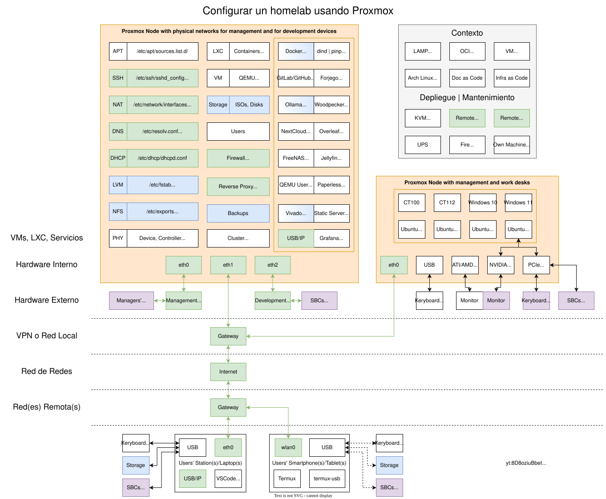

# ITSAS - Homelab

This repository gathers references and examples of configuration files related to setting up a homelab using Proxmox for
learning and testing purposes.



## Masquerading and port forwarding

Since the SBCs connected to the internal network are not inventoried, just sharing the two networks through the
gateway does not work.
The university network detects packets coming from multiple MACs and/or IPs on the same interface, which is not allowed,
and ethernet ports are temporarily blocked by the IT service.
A similar issue arises when running multiple virtual machines on a single machine, such as done on Proxmox.
In order to work around such limitation, IP masquerading is required:

> https://tldp.org/HOWTO/IP-Masquerade-HOWTO/ipmasq-background2.1.html
>
> *MASQ allows a set of machines to invisibly access the Internet via the MASQ gateway. To other machines on the
> Internet, the outgoing traffic will appear to be from the IP MASQ Linux server itself.*

Masquerading is configured through [wikipedia: iptables](https://en.wikipedia.org/wiki/Iptables).
See also [pve.proxmox.com/wiki: Network_Configuration > Masquerading (NAT) with iptables](https://pve.proxmox.com/wiki/Network_Configuration#_masquerading_nat_with_tt_span_class_monospaced_iptables_span_tt).

By default, services running on any of the boards connected to the internal network are not visible from the university
network.
That's desired, indeed.
Yet, in some cases (e.g. SSH), we might want to have access to those services from our development workstations without
requiring a user on the gateway.
Port forwarding, which is also configured through `iptables`, allows transparently exposing specific ports of specific
devices through the gateway.

[host.interfaces](host.interfaces) is an example of `/etc/network/interfaces`.

- `eth0` connected to the management network; configuration is automatic (through the default DHCP) but fixed to
  `192.168.1.103/24` on the Management Switch.
- `eth1`: connected to the university network; configuration is automatic (through the default DHCP).
- `eth2` connected to the SBCs network; statically set to `10.10.10.1/24`.

## DHCP

Setting the IP addresses of each board or VM statically is not a big effort, but it is error-prone, particularly if the
systems are to be changed frequently.
Moreover, the gateway and DNS servers do also need to be configured for them to browse the internet.
Particularly, if an internal DNS server is used, it needs to be configured for the boards/VMs to find other boards/VMs.
In order to ease the setup and reduce the maintenace burden, a [wikipedia: Dynamic Host Configuration Protocol (DHCP)](https://en.wikipedia.org/wiki/DHCP)
server is run on the boards network and on each of the virtual VM networks.
Currently, the [ISC DHCP](https://www.isc.org/dhcp/) server is used.

> NOTE:
> On Proxmox, service isc-dhcp-server exists by default, but it exits right after starting because package
> `isc-dhcp-server` is not installed.
> When installed, the service is enabled but it will fail unless properly configured.
> Hence, either edit the configuration files or disable it until that's done.

After installing `isc-dhcp-server` (Debian) or `dhcp-server` (Fedora) and updating the configuration (see
[wiki.debian.org/DHCP_Server](https://wiki.debian.org/DHCP_Server)), the service is managed through:

```
$(command -v sudo) systemctl <status|enable|disable|start|restart|stop> <isc-dhcp-server|dhcpd>
```

[host.dhcpd.conf](host.dhcpd.conf) is an example of `/etc/dhcp/dhcpd.conf`.
The internal DHCP server provides a centralised source of truth and it allows all the boards and VMs to automatically
configure their addresses, gateway and DNS servers.

### Notes

- In order to disable the DHCP on IPv6, edit `/etc/default/isc-dhcp-server` to specify the interfaces for IPv4 and leave
the ones for IPv6 empty.
For instance:

  ```
  INTERFACESv4="vmbr1 enp1s0"
  INTERFACESv6=""
  ```

- The machine where the service is to be started needs to have a network device with an IP assigned to the subnet where
  IPs managed.
  For instance, in order to handle IPs in subnet `10.10.10.0`, the IP of a network device on the machine needs to be
  `10.10.10.X`.
  Otherwise, starting dhcpd will fail.

- For historic reasons, on Proxmox (Debian) services can be managed through either `systemctl` (systemd) or `service` (SysVinit).
  However, `systemctl` is the newer approach and does support `enable|disable`, which `service` does not allow per se.
  Therefore, it is recommended to use `systemctl` for managing services.
  See [unix.stackexchange.com: How do services in Debian work, and how can I manage them?](https://unix.stackexchange.com/questions/106656/how-do-services-in-debian-work-and-how-can-i-manage-them) and [fosslinux.com: How to start, stop, and restart services on Debian](https://www.fosslinux.com/50724/how-to-start-stop-and-restart-services-on-debian.htm).

## SSH

On Ubuntu, an SSH client might be available by default but not a server.
The most used/known SSH server is `openssh-server`.
Use the following commands to install and enable it on VMs or LXCs:

```sh
sudo apt install openssh-server
sudo service sshd enable
```

## NFS

On top of sharing computing resources (either VMs, GPUs or FPGAs/SoCs), we need to share data, tools, articles/reports
and results.
While articles and reports are mostly used by people, tools, data and results are to be consumed/produced by the
services running on the VMs.

### Server

The most straightforward approach on GNU/Linux is to use [wikipedia: NFS](https://en.wikipedia.org/wiki/Network_File_System) by
running an `nfs-kernel-server` service on the host.
After installing it and updating the configuration (see [wiki.debian.org/NFSServerSetup](https://wiki.debian.org/NFSServerSetup)),
the service is managed through:

```
$(command -v sudo) systemctl <status|enable|disable|start|restart|stop> nfs-kernel-server
```

[host.exports](host.exports) is an example of `/etc/exports`.
The explanation of the options can be found in the NFS exports man page (see [linux.die.net/man/5/exports](https://linux.die.net/man/5/exports)).

The following options are particularly relevant in our setup:

- `rw|ro`: whether the exported resource is read-only or read-write.
- `sync`: reply to request only after the changes have been commited; this is the default after 1.0.0.
- `no_subtree_check`, `nohide` and `crossmnt`: since the exports contain multiple filesystems (mounted on each other),
  these options are required for the clients to see the resources.
- `no_root_squash`: turn off uid 0 being mapped to a different id (so-called anonymous or *nobody* id).

#### Notes

- Ideally, we should run as few services as possible on the host; so, it'd be better to run NFS on a VM or container.
  However, running the service on a VM/container would require additional networking setup for the content to be
  available outside of the host (i.e. from user workstations or laptops).
  Since we don't want to deal with such complexity (for now), we are keeping it simple (albeit less secure).

- As the name suggests `nfs-kernel-server` is a service that uses the kernel.
  Therefore, it is not straightforward to run NFS on a container.
  While a VM does have a kernel isolated from the host (by trading performance), a container needs to be privileged to
  use the kernel on the host.
  It is technically possible to create a custom configuration for a container to have enough privileges for running NFS,
  however, we don't want to deal with such complexity yet.

### Client

In order to access the exported resources from clients, `nfs-common` (Debian|Ubuntu) tools are required.
Then, `mount` can be used (e.g. `sudo mount 10.10.200.1:/mnt/vault/data /opt/data`) or `/etc/fstab` can be edited.

[CT100.host.fstab](CT100.host.fstab) is an example of the `/etc/fstab` file on a LXC.

#### Notes

- `showmount` allows listing all the visible exports.

- Windows 7, 8.1, 10 and 11 support accessing NFSv2 and NFSv3 exports.
  However, the feature might need to be enabled.
  See [learn.microsoft.com: Windows Server / Network File System overview](https://learn.microsoft.com/en-us/windows-server/storage/nfs/nfs-overview).

### Security and permissions

As explained in [web.mit.edu/rhel-doc/5/RHEL-5-manual: Securing NFS](https://web.mit.edu/rhel-doc/5/RHEL-5-manual/Deployment_Guide-en-US/s1-nfs-security.html):

> NFS controls who can mount an exported file system based on the host making the mount request, not the user that
> actually uses the file system.
> Hosts must be given explicit rights to mount the exported file system.
> Access control is not possible for users, other than through file and directory permissions.
> In other words, once a file system is exported via NFS, any user on any remote host connected to the NFS server can
> access the shared data.

> Additionally, if an attacker gains control of the DNS server used by the system exporting the NFS file system, the
> system associated with a particular hostname or fully qualified domain name can be pointed to an unauthorized machine.
> At this point, the unauthorized machine is the system permitted to mount the NFS share, since no username or password
> information is exchanged to provide additional security for the NFS mount.

Actually, strong security is one of the big advantages of NFSv4 over its predecessors, apart from using a single UDP/TCP
port, which simplifies using the protocol across firewalls (see [Wikipedia: Network File System](https://en.wikipedia.org/wiki/Network_File_System)).

We are currently using NFSv3 because we are unsure about NFSv4 clients being available on all the systems we use.
Therefore, security is currently based on the IP addresses of the clients.
We do have DHCP services running on the hosts, which provide fixed addresses to the VMs, based on their MAC.
Yet, we do *not* have all users and ids duplicated on the server.
I.e., we use root squashing and, as a result, user access control is effectively non-existing.
We rely on users behaving properly and not modifying the resources they are not expected to.

Since IP masquerading is used, it is not straightforward to export a resource to some client VMs on a different node only.
The VMs on each node are connected to a virtual network which is not visible outside.
Therefore, resources would need to be shared with the host and all the machines on the other node.
Additional firewall rules would be required on the other node to prevent some VMs from accessing the content shared through NFS.

Furthermore, it seems not possible to reexport NFS mounts.

### Backups

If partitions or LVs from the host are shared straightaway (without using Proxmox's disk management features), backups cannot de handled as done with the VMs.
Users need to take care of making backups of the data they use, and they need to assume that the shared resources might
disappear.

## DNS

Since using IPs for each board/service can get complex, [wikipedia: Domain Name System (DNS)](https://en.wikipedia.org/wiki/Domain_Name_System)
[wikipedia: name server](https://en.wikipedia.org/wiki/Name_server) allows using names which are easier to remember.

## Reverse proxy

A DNS service can only translate names to IPs, it cannot forward ports per se.
Furthermore, multiple ports from the internal network cannot be directly exposed in the same port of the gateway,
because incoming connections would not know which device to target.
As a result, DNS names alone are not particularly useful for users connecting through the forwarded services;
they still need to specify ports.

A [wikipedia: reverse proxy](https://en.wikipedia.org/wiki/Reverse_proxy) allows distributing namespaces to different IPs and ports.
By combining a DNS server and a reverse proxy, forwarding ports through iptables would not be required.

## Context

- [phrack.org](https://phrack.org/) Volume One, Issue 7, Phile 3 of 10: [The Conscience of a Hacker](https://phrack.org/issues/7/hackers-manifesto#article) by The Mentor, written on January 8, 1986 ([W: The Conscience of a Hacker](https://en.wikipedia.org/wiki/Hacker_Manifesto) aka The Hacker Manifesto):
  - "I made a discovery today. I found a computer. Wait a second, this is
cool. It does what I want it to. If it makes a mistake, it's because I
screwed it up".
  - "I know everyone here... even if I've never met them, never talked to
them, may never hear from them again... I know you all...".
  - "We exist without skin color, without nationality, without religious bias...".
  - "You may stop this individual, but you can't stop us all... after all, we're all alike".
- [¿Por qué me enamoré de los hackers?](https://www.mercemolist.net/webantiga/literature/lovehackers.html) (también en [elmundo.es/2012/05/25/navegante](https://www.elmundo.es/elmundo/2012/05/25/navegante/1337954941.html)) por [Mercè Molist](https://www.mercemolist.net/)
  - "Un hacker, dice un amigo, es alguien capaz de encontrar una solución elegante a un problema importante".
  - "...quien entra, cambia. Mucho o poco, pero cambian sus conexiones neuronales y sociales, se activan ideas y un sentido de la moral que quizás ya tenía, pero estaba durmiendo, sin espacio donde expresarse".
  - "Toda la información debería ser libre".
  - "No creas a la autoridad, promueve la descentralización".
- [hackstory.es](https://hackstory.es/), fundado por Mercé Molist en formato wiki y después editado como libro (descargable en EPUB, PDF, MOBI) y en formato físico:
  - [Prehistoria](https://hackstory.net/Hackstory.es_Prehistoria.html): "En España, en los años 70, los hackers eran cuatro gatos. En 1985, los centros de cálculo de cada universidad no tenían más de 2, máximo 3 ordenadores...". "Quedan escritos en los documentos de las universidades los nombres de quienes tenían responsabilidades: ... en la Universidad del País Vasco ...".
  - [Los primeros grupos de hackers](https://hackstory.net/Hackstory.es_Los_primeros_grupos_de_hackers.html): "El grupo se llamaba Glaucoma porque atacaban a la red Iris (que conectaba los centros de investigación académica)".
- [How To Ask Questions The Smart Way](http://www.catb.org/~esr/faqs/smart-questions.html) by Eric S. Raymond and Rick Moen
  - [W: Netiquette](https://en.wikipedia.org/wiki/Etiquette_in_technology)
- [The Cathedral and the Bazaar](https://catb.org/~esr/writings/cathedral-bazaar/cathedral-bazaar/) by Eric S. Raymond
  - [W: The Cathedral and the Bazaar](https://en.wikipedia.org/wiki/The_Cathedral_and_the_Bazaar)
  - [W: Monty Python's Life of Brian](https://en.wikipedia.org/wiki/Monty_Python%27s_Life_of_Brian)
- [es.hackmeeting.org](https://es.hackmeeting.org)
  - [W[ES]: Hackmeeting](https://es.wikipedia.org/wiki/Hackmeeting)
  - [10 lecturas sobre Hacktivismo](https://sindominio.net/xabier/textos/evhack/10_lecturas_hacktivismo.pdf) by EVhAck
    - [sindominio.net/xabier](https://sindominio.net/xabier/)
    - [xabier.barandiaran.net](https://xabier.barandiaran.net/)
    - Revista @rroba
  - [Temporary Autonomous Zone](https://en.wikipedia.org/wiki/Temporary_Autonomous_Zone) by Hakim Bey
    - [archive.org: T.A.Z.](https://archive.org/details/T.A.Z.TheTemporaryAutonomousZoneOntologicalAnarchyPoeticTerrorism)
    - [Burning Man Project](https://burningman.org/)
      - [W: Burning Man](https://en.wikipedia.org/wiki/Burning_Man)
- [guifi.net](https://guifi.net)
  - [W: guifi.net](https://en.wikipedia.org/wiki/Guifi.net)
- [[DEF CON 22] Hack All The Things: 20 Devices in 45 Minutes](https://www.youtube.com/watch?v=3V_6So4MNgo)
- ITSAS 2013/02/05 'Re: [Itsas] Creación de grupo trac' Javier Domingo
  - [SIR - The RedIRIS Identity Federation](https://www.rediris.es/sir/)
  - [txmon.com: Reverse engineering the authentication of your University](https://txomon.com/post/2012/12/13/reverse-engineering-the-authentication-of-your-university/)
